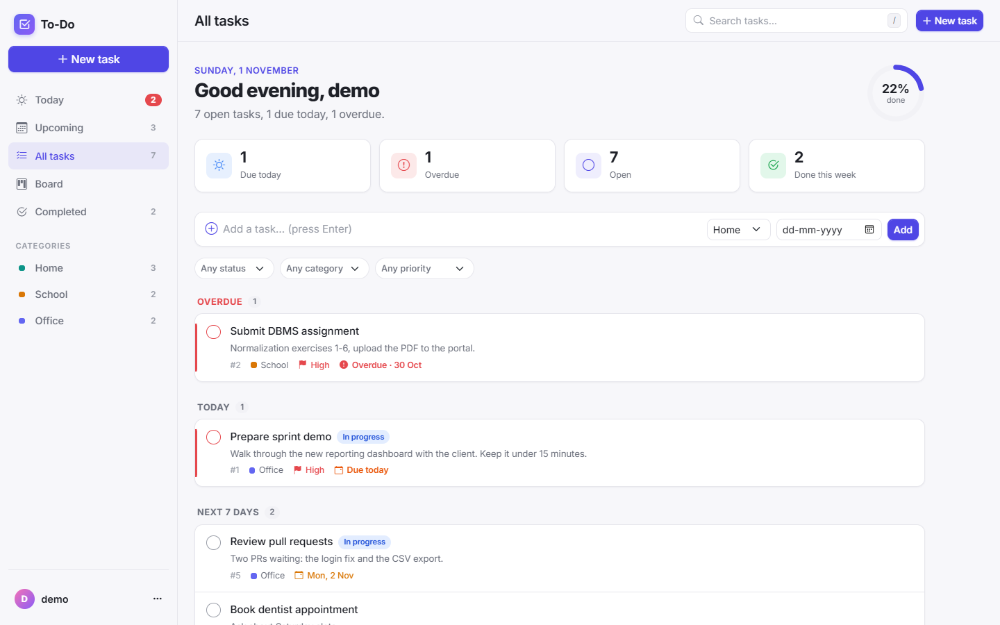
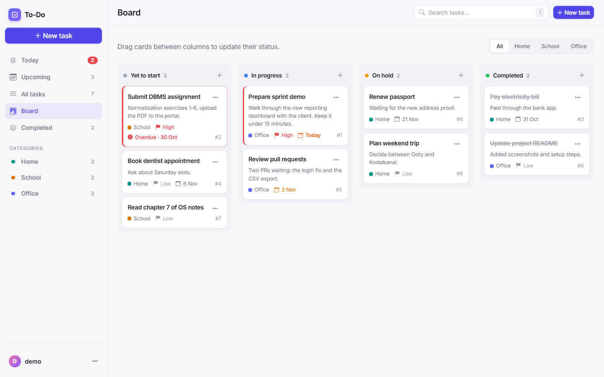
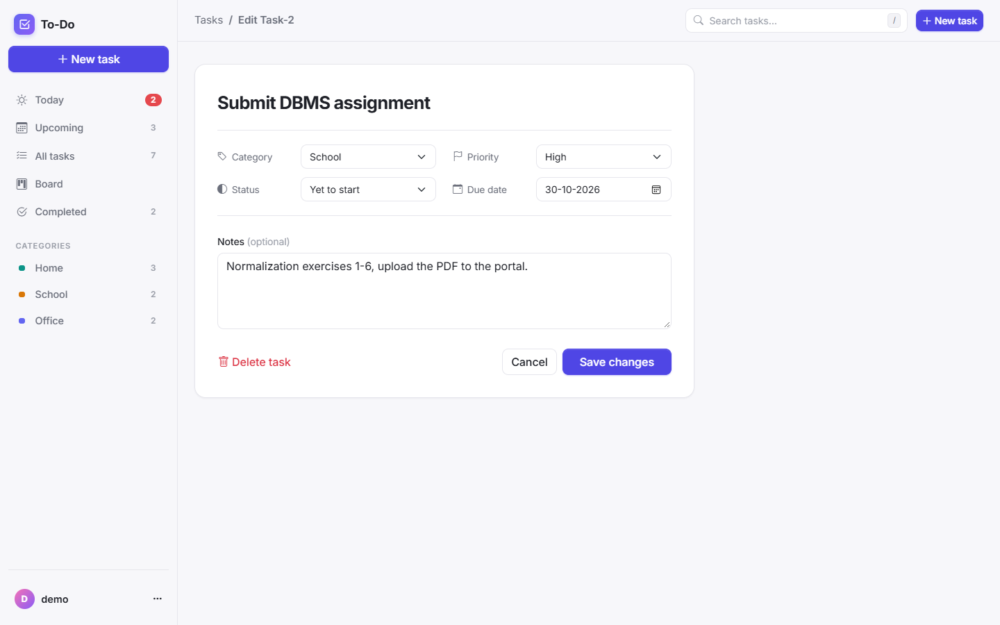
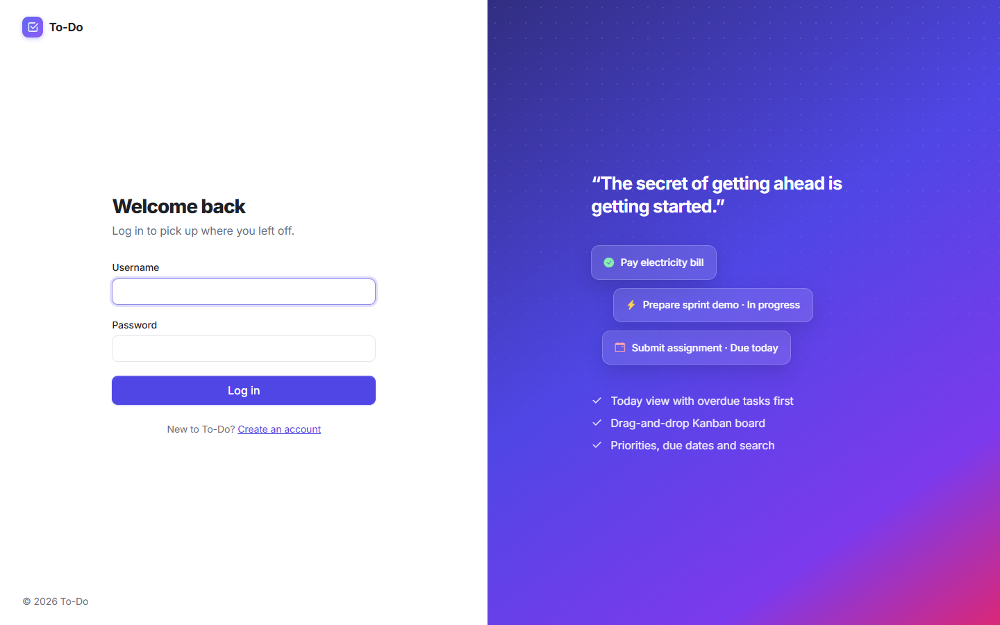
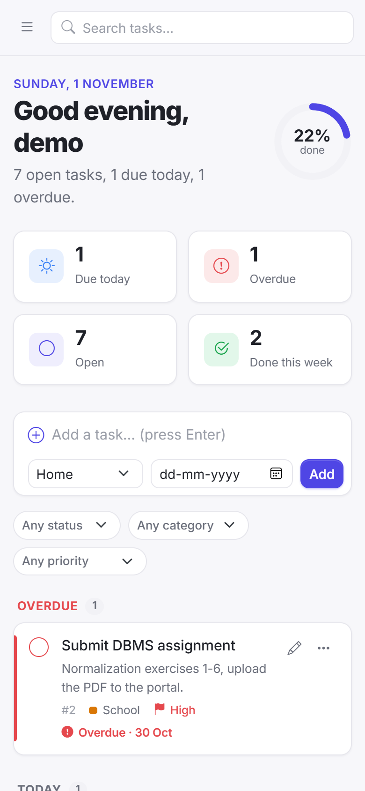

# To-Do — Task Manager

[](https://github.com/Kishore-1011/To-Do-list/actions/workflows/tests.yml)


A task manager built with Django. Each user gets a private workspace with a task list grouped by due date, a drag-and-drop Kanban board, priorities, due-date alerts, quick add, search and filters.



## Features

- **Accounts:** sign up, log in and log out; every user only ever sees their own tasks
- **Task list grouped by due date:** Overdue, Today, Next 7 days, Later and No due date, with completed tasks folded at the bottom
- **Sidebar views:** Today, Upcoming, All tasks, Board and Completed, plus category shortcuts, each with live counts
- **Kanban board:** drag cards between *Yet to start*, *In progress*, *On hold* and *Completed*; changes save instantly. Works with touch, and every card also has a "Move to" menu for keyboard users
- **Quick add:** type a task, pick a category and optional due date, press Enter
- **Task details:** category (Home, School, Office), priority (Low, Medium, High), status, due date and notes
- **Due-date alerts:** overdue, due-today and due-soon tasks are highlighted, and the dashboard shows a progress ring and weekly stats
- **One-click complete:** tick a task off and the completion time is recorded; tick again to reopen
- **Search and filters:** search by name or notes (press `/` from anywhere), and filter by status, category or priority
- **Responsive:** sidebar layout on desktop, slide-in menu on phones

| Kanban board | Edit a task |
|---|---|
|  |  |

| Log in | Mobile |
|---|---|
|  |  |

## Tech stack

- **Backend:** Python, Django 5.2 LTS
- **Database:** SQLite for local development
- **Frontend:** Django templates, Bootstrap 5.3, Bootstrap Icons, custom CSS, SortableJS for drag and drop
- **Static files:** WhiteNoise
- **Testing / CI:** Django test framework, GitHub Actions on Python 3.12 and 3.13

## Getting started

**Requirements:** Python 3.12 or newer.

```bash
git clone https://github.com/Kishore-1011/To-Do-list.git
cd To-Do-list

python -m venv .venv
source .venv/bin/activate        # Windows: .venv\Scripts\activate
pip install -r requirements.txt

cp .env.example .env             # local settings (debug on, dev secret key)
python manage.py migrate
python manage.py runserver
```

Open http://127.0.0.1:8000 and create an account. To use the Django admin as well, run `python manage.py createsuperuser` and go to http://127.0.0.1:8000/admin.

### Configuration

Settings are read from environment variables, or from a `.env` file:

| Variable | Description | Default |
|---|---|---|
| `DJANGO_DEBUG` | Turns on debug mode | `False` |
| `DJANGO_SECRET_KEY` | Secret key; required when debug is off | dev-only key when debug is on |
| `DJANGO_ALLOWED_HOSTS` | Comma-separated host names | `localhost,127.0.0.1` |
| `DJANGO_CSRF_TRUSTED_ORIGINS` | Full origins allowed to submit forms over HTTPS | empty |

## Running tests

```bash
python manage.py test
```

The 44 tests cover the task model (numbering, completion time, due-date states), forms, sign-up and login (including safe redirects), the list views and grouping, filters, quick add, the board's status updates, and access control: other users get a 404 for every task action, and requests without a CSRF token are rejected.

## Security

- Every task view looks tasks up by **both** ID and owner, so one user can never view, edit, complete or delete another user's tasks
- Changes are POST-only and CSRF-protected, including logout, delete and drag-and-drop status updates
- `?next=` redirects are only followed when they point back to this site
- In production (`DJANGO_DEBUG=False`) the app requires a secret key from the environment and uses secure cookies

## Project structure

```
To-Do-list/
├── Task/                        # Main app
│   ├── context_processors.py    # Sidebar counts on every page
│   ├── forms.py                 # Sign-up, login and task forms
│   ├── models.py                # Task: status, priority, due date, completion time
│   ├── views.py                 # List, board, create/edit/delete, status updates
│   ├── tests.py
│   ├── migrations/
│   ├── static/                  # CSS, JavaScript (board drag and drop), images
│   └── templates/               # App shell, sidebar, list, board, auth pages
├── To_Do/                       # Project settings and URLs
├── .github/workflows/tests.yml  # CI
└── requirements.txt
```

## History

I first built this in January 2024 as a simple task list with categories. In 2026 I revisited it and:

- fixed a security issue where any logged-in user could edit or delete other users' tasks
- upgraded to Django 5.2 LTS with environment-based settings
- added task status, priorities, due dates and completion tracking
- built the Kanban board with drag and drop
- redesigned the interface as a sidebar-based workspace
- added a test suite and continuous integration
